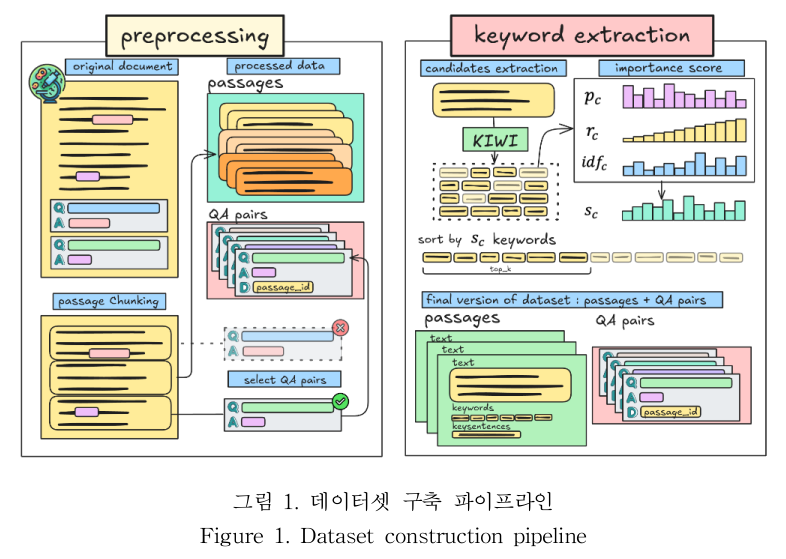

# K-RAG: Korean paper-based Retrieval-Augmented Generation Dataset

K-RAG는 **전문 도메인**에 특화된 **한국어 RAG(Retrieval-Augmented Generation)** 데이터셋으로,  
질문에 대한 응답 생성을 위해 핵심 문서 정보(`keyphrase`, `key sentence`)를 활용합니다.

🔗 K-RAG 데이터셋 링크: https://aida.kisti.re.kr/data/fc4da4bd-61b1-43ae-b394-4d52dff96c1a

---


## 데이터 구성

각 샘플은 다음 정보를 포함합니다:

- `id`: 각 샘플의 고유 식별자
- `question`: 사용자 질문
- `answer`(Optional): 모델이 생성해야 할 응답
- `keyphrases`: 문서에서 추출된 핵심 구문 목록
- `key_sentences`: 문서 내 주요 문장
- `gold_passage_id`(Optional): 정답 본문 ID

---


## 데이터셋 통계

| Split  | Samples |
|--------|---------|
| Train  | 54,224  |
| Valid  | 6,778   |
| Test   | 6,779   |

**문서 컬렉션 (검색 코퍼스)**
* 총 문서 수: 8,177,265

총 **67,781개**의 전문 QA 샘플이 포함되어 있으며,  
분야별 도메인 전문성과 정보 압축성을 갖춘 RAG 학습에 적합합니다.

## 데이터셋 예시

```json
{
  "id": 23844,
  "question": "로봇 영상처리 분야가 까다로운 문제인 동시에 더욱더 많은 연구가 필요한 현실인 이유는 무엇인가?",
  "answer": "로봇 영상처리 분야는 조명 변화에 민감하고, 물체가 겹치거나 배경과 혼동되는 문제로 인해 까다롭습니다. 이러한 문제들은 로봇이 정확하게 인식하고 추적하는 데 큰 도전이 되며, 특히 수중 환경에서는 더욱 복잡해집니다. 따라서 이 분야는 지속적인 연구와 발전이 필요합니다.",
  "keyphrases": [
      "색깔 히스토그램",
      "Bayesian 추정 법",
      "활약",
      "로봇 영상처리 분야",
      "조명변화",
      "추종 기법들",
      "meanshift 방법",
      "카메라 영상",
      "연구 주제",
      "민감"
  ],
  "key_sentences": {
      "sentences": [
          "이들 중 색깔 히스토그램을 사용하는 meanshift 방법[1～3]이나 특징점을 이용한 방법들[4～6] Bayesian 추정 법을 통한 추종 기법들[7～8]은 많은 쓰임새를 보이고 있지만 이 분야는 여전히 까다로운 문제인 동시에 더욱더 많은 연구가 필요한 현실이다.",
          "여기에 로봇이 수중에서 활약해야 하는 경우 그 문제는 더더욱 어려워 질 수 있다.",
          "인지와 추종은 로봇 영상처리 분야에서 핵심적인 연구 주제이며 근래에도 많은 연구를 이루어져 왔고, 그 결과.",
          "그 이유는 카메라 영상은 조명변화에 민감하게 변화하고 추종하고 있는 물체가 주변에 있는 물체와 겹쳐져 사라질 경우, 또는 추종중인 물체가 배경에 속하는 영상과 혼동되는 등의 경우는 아주 쉽게 접할 수 있는 문제들이기 때문이다."
      ],
      "top-3": [0, 1],
      "top-4": [0, 1, 2],
      "top-5": [0, 1, 2, 3]
  },
  "gold_passage_id": "JAKO201106736916889-0"
}
```
---

